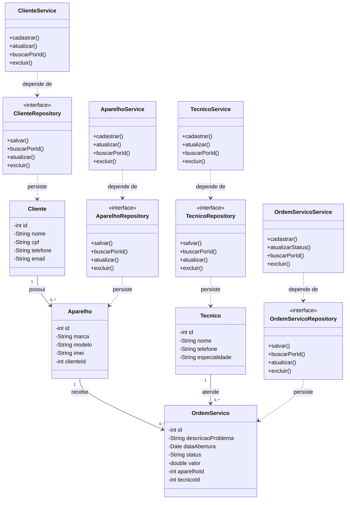

# Modelagem do Projeto 1

## 1. Domínio

O projeto consiste em um Sistema de Gestão para Assistência Técnica e Loja de Celulares. O sistema permitirá cadastrar clientes, aparelhos, técnicos e ordens de serviço, facilitando o acompanhamento dos reparos realizados. O objetivo é organizar as informações dos atendimentos e identificar o técnico responsável por cada serviço.

## 2. Entidades, atributos e relacionamentos

### 2.1 Cliente

**Atributos:**
- `id`: identificador único do cliente.
- `nome`: nome completo.
- `cpf`: CPF do cliente.
- `telefone`: telefone para contato.
- `email`: e-mail do cliente.

**Relacionamento:** um cliente pode possuir vários aparelhos, e cada aparelho pertence a um único cliente (1:N).

**Responsabilidades:**
- `ClienteService`: aplica as regras de negócio, como validar os dados obrigatórios e impedir CPF duplicado.
- `ClienteRepository`: define as operações de persistência e consulta dos clientes.

### 2.2 Aparelho

**Atributos:**
- `id`: identificador único do aparelho.
- `marca`: fabricante do aparelho.
- `modelo`: modelo do dispositivo.
- `imei`: identificação do aparelho.
- `clienteId`: identificador do cliente proprietário.

**Relacionamento:** cada aparelho pertence a um cliente e pode estar associado a várias ordens de serviço ao longo do tempo (1:N).

**Responsabilidades:**
- `AparelhoService`: aplica as regras de cadastro, como validar os dados do aparelho e verificar se o cliente existe.
- `AparelhoRepository`: define as operações de persistência e consulta dos aparelhos.

### 2.3 Tecnico

**Atributos:**
- `id`: identificador único do técnico.
- `nome`: nome do técnico.
- `telefone`: telefone para contato.
- `especialidade`: área de atuação do técnico.

**Relacionamento:** um técnico pode ser responsável por várias ordens de serviço (1:N).

**Responsabilidades:**
- `TecnicoService`: aplica as regras de negócio relacionadas ao cadastro e à validação dos técnicos.
- `TecnicoRepository`: define as operações de persistência e consulta dos técnicos.

### 2.4 OrdemServico

**Atributos:**
- `id`: identificador único da ordem de serviço.
- `descricaoProblema`: descrição do defeito informado.
- `dataAbertura`: data de abertura da ordem.
- `status`: situação do atendimento, como `ABERTA`, `EM_REPARO` ou `CONCLUIDA`.
- `valor`: valor previsto ou cobrado pelo serviço.
- `aparelhoId`: identificador do aparelho atendido.
- `tecnicoId`: identificador do técnico responsável.

**Relacionamento:** cada ordem de serviço está associada a exatamente um aparelho e a exatamente um técnico responsável. Um aparelho pode possuir várias ordens de serviço, e um técnico pode atender várias ordens (1:N em ambos os casos).

**Responsabilidades:**
- `OrdemServicoService`: aplica as regras de negócio, como validar a transição de status e verificar se o aparelho e o técnico existem.
- `OrdemServicoRepository`: define as operações de persistência e consulta das ordens de serviço.

## 3. Diagrama de classes

## 4. Aplicação dos princípios SRP e DIP

O princípio SRP (Single Responsibility Principle) foi aplicado separando as responsabilidades das entidades, dos services e dos repositories. As entidades representam os dados do domínio, os services concentram as regras de negócio e os repositories definem as operações de persistência e consulta. Dessa forma, cada classe possui uma responsabilidade principal e um único motivo para mudar.

O princípio DIP (Dependency Inversion Principle) foi aplicado fazendo com que os services dependam das interfaces dos repositories, e não de implementações concretas ou diretamente do banco de dados. Os repositories definem os contratos de acesso aos dados, permitindo que a implementação da persistência seja substituída sem modificar as regras de negócio. No diagrama, as dependências dos services apontam para os repositories, sem dependência direta do banco de dados.
